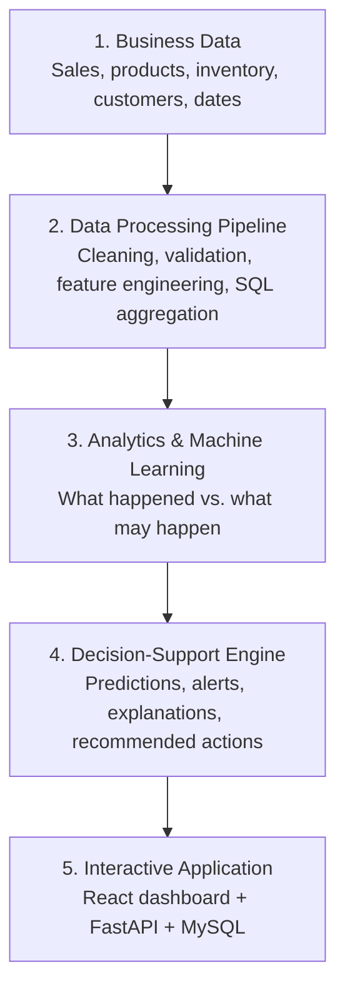

<div align="center">

# AI-Powered Business Intelligence & Decision Support System

**Machine Learning for Sales Forecasting, Customer Segmentation and Inventory Optimization**


*A final-year major project that turns historical retail data into forecasts, customer insights and evidence-backed business recommendations.*

</div>

---

## Table of Contents

- [Overview](#overview)
- [Key Questions the System Answers](#key-questions-the-system-answers)
- [How the System Works](#how-the-system-works)
- [Modules](#modules)
- [Technology Stack](#technology-stack)
- [System Architecture](#system-architecture)
- [Database Design](#database-design)
- [Datasets](#datasets)
- [Model Evaluation Approach](#model-evaluation-approach)
- [Project Structure](#project-structure)
- [Getting Started](#getting-started)
- [Roadmap](#roadmap)
- [Contributing](#contributing)
- [License](#license)
- [Acknowledgements](#acknowledgements)

---

## Overview

This project is an intelligent platform that helps a retail business understand sales performance, forecast demand, identify customer groups, discover product associations and make better inventory decisions.

Rather than only displaying charts, the system **analyzes historical business data, produces predictions and turns the results into evidence-backed recommendations**. It combines:

- **Descriptive analytics**: what happened, and why
- **Predictive machine learning**: what may happen next
- **Relational database design**: structured, versioned, auditable records
- **A full-stack web application**: dashboards, alerts and decision support

The project starts with a single business domain (**retail**) so that datasets, schema and demonstration remain coherent.

> **Project status:** This repository is under active development. The modules below describe the intended scope; see the [Roadmap](#roadmap) for current progress.

---

## Key Questions the System Answers

- Which products generate the most **revenue and profit**?
- How much **stock** may be needed next month?
- Which customers purchase **frequently** or contribute the **most value**?
- Which products are **often purchased together**?
- **Why** did sales change sharply during a particular period?
- Which inventory items may need **replenishment**?

---

## How the System Works



The system accepts uploaded datasets and/or records entered through the interface, validates and cleans the data, stores structured records in MySQL, runs analytics and trained ML models, and presents the results through dashboards, alerts and recommendations.

---

## Modules

### Module 1: Sales, Profit and Business Analytics
The descriptive-analytics foundation of the platform.

- Total revenue, total orders, units sold and profit
- Daily, weekly, monthly and yearly sales trends
- Best-selling and least-selling products
- Sales and profit comparisons across categories and time periods
- Filters for product, category, date and customer segment
- KPIs such as growth rate, average order value and gross profit margin

> **Example:** If sales rise from ₹5,00,000 (August) to ₹6,00,000 (September), growth = `((600000 − 500000) / 500000) × 100 = 20%`. The system reports the growth and lets the user inspect which categories contributed.

**Tools:** Pandas, NumPy, SQL aggregations

---

### Module 2: Sales and Demand Forecasting
Estimates future sales or demand for individual products using historical data.

**Workflow**
1. Aggregate transactions into daily or weekly product-level sales
2. Handle missing dates, returns and unusual values
3. Engineer features (previous-week sales, previous-month sales, day of week, month of year)
4. Train and compare forecasting models
5. Predict demand for a future period
6. Display forecasts alongside historical sales
7. Store predictions and compare them with actual results once available

| Model | Purpose |
|---|---|
| Moving Average | Simple baseline for comparison |
| Random Forest Regressor | Learns nonlinear patterns from engineered features |
| XGBoost Regressor | Candidate model for tabular forecasting features |
| Seasonal forecasting model | Captures recurring patterns when the data supports seasonality |

---

### Module 3: Customer Segmentation
Groups customers by purchasing behavior using **RFM analysis** and clustering.

- **Recency**: how recently a customer purchased
- **Frequency**: how often the customer purchases
- **Monetary value**: how much the customer spends

**Approach:** Standardize features → run **K-Means** → choose the cluster count → evaluate with **silhouette score** → interpret each cluster before assigning a business label.

| Example segment | Suggested engagement |
|---|---|
| High-value customers | Loyalty benefits |
| New / occasional customers | Relevant introductory offers |
| At-risk / inactive customers | Investigate engagement changes; re-engagement campaign |

> K-Means produces mathematical groups; their business meaning is established through analysis of each cluster.

---

### Module 4: Product Recommendations and Cross-Selling
Identifies products that frequently appear together in orders (e.g., phone cases bought with a particular phone) to support bundles and complementary-product suggestions.

- Market basket analysis with association rules
- Apriori / FP-Growth algorithms
- Collaborative filtering (if sufficient user-item data is available)

| Measure | Meaning |
|---|---|
| **Support** | How often the items appear together |
| **Confidence** | How often one item is bought when another is bought |
| **Lift** | How much stronger the association is than expected under independence |

> Associations are useful signals, but they do not prove that one product *causes* another to sell.

---

### Module 5: Inventory Optimization and Intelligent Alerts
Connects demand estimates to operational decisions.

- Current stock levels and inventory value
- Low-stock and potential stockout alerts
- Estimated days of inventory remaining
- Suggested reorder quantities
- Slow-moving and excess-stock identification
- Alerts for unusual changes in sales

> **Example:** 20 units in stock with forecast demand of 5 units/day gives `20 / 5 = 4 days` of stock. If supplier lead time exceeds four days, the item is flagged for review.
>
> **Reorder point** = expected lead-time demand + safety stock

Supplier lead times, incoming orders and existing reservations are considered where records are available. Unusual-sales alerts start with transparent rolling statistical thresholds, with **Isolation Forest** evaluated as an extension.

---

### Module 6: Business Decision-Support and Recommendations
Combines findings from all modules into suggested actions with supporting evidence, turning a collection of charts and models into a true decision-support system.

| Observation | Evidence | Suggested action |
|---|---|---|
| Sales decline | The selected category declined versus the previous period | Inspect product-level trends and inventory availability before planning a promotion |
| Potential stockout | Forecast demand may exceed stock before the next expected delivery | Review reorder quantity and supplier lead time |
| Weaker customer engagement | A segment shows reduced purchasing frequency | Investigate the change and consider a targeted retention campaign |

Recommendations are initially **rule-based and traceable** to real analytics and ML outputs, which keeps advice testable and avoids invented explanations. **SHAP** can later be added to explain feature contributions for suitable models.

---

### Module 7: Natural-Language Business Queries *(Optional Extension)*
Lets a business owner ask questions such as *"Show the five products with the highest profit"* or *"Which products are at risk of running out of stock?"*

**Safe-implementation principles**
- Start with a defined set of supported business questions
- Map questions to approved SQL queries or structured analytical functions
- Validate parameters and enforce user permissions
- Use read-only database access
- **Never** execute unrestricted model-generated SQL against the database

An LLM may help interpret questions but is not required for the core ML system.

---

## Technology Stack

| Layer | Technologies |
|---|---|
| **Presentation** | React, TypeScript, Tailwind CSS |
| **Application** | FastAPI, SQLAlchemy |
| **Data Science** | Python, Pandas, NumPy, scikit-learn, XGBoost |
| **Data** | MySQL |
| **Optional tools** | Plotly (interactive charts), SHAP (model explainability), Docker (reproducible deployment), Git & GitHub |

---

## System Architecture

| Layer | Responsibilities |
|---|---|
| **Presentation layer** | Dashboards, filters, forecast charts, data tables and alerts |
| **Application layer** | Authentication, API endpoints, validation, business logic and access control |
| **Data science layer** | Preprocessing, exploratory analysis, forecasting, clustering, recommendations and evaluation |
| **Data layer** | Transactions, inventory, users, predictions, model metadata and alerts |

---

## Database Design

MySQL is a core component of the system, storing business records, predictions, alerts and history, with primary keys, foreign keys and appropriate indexes.

| Table | Stores |
|---|---|
| `users` | User accounts, roles and permissions |
| `customers` | Customer identifiers and relevant attributes |
| `products` | Product names, categories, prices and costs |
| `orders` | Order date, customer and order status |
| `order_items` | Products, quantities, selling prices and discounts per order |
| `inventory` | Current stock and reorder settings |
| `suppliers` | Supplier information and lead times |
| `forecasts` | Predicted demand, forecast dates and model version |
| `customer_segments` | Customer cluster assignments and dates |
| `recommendations` | Suggested business actions and supporting evidence |
| `alerts` | Low-stock alerts, anomaly alerts and resolution status |

One order can contain several order items, and each order item references a product. This supports revenue analysis by product, category, customer and time period without unnecessary duplication. Prediction timestamps and model versions are stored so historical forecasts can be compared with actual outcomes.

---

## Datasets

| Dataset | Used for | Source |
|---|---|---|
| UCI Online Retail | Sales analysis, customer segmentation, market basket analysis | [UCI ML Repository](https://archive.ics.uci.edu/dataset/352/online+retail) |
| Kaggle store-sales datasets | Forecasting across products or stores | [Kaggle Datasets](https://www.kaggle.com/datasets) |
| Supplementary inventory data | Inventory alerts and reorder suggestions | Documented compatible source, or clearly labelled simulated data |

**Data strategy:** Build sales analytics, segmentation and product associations from one reliable transactional dataset first, then add forecasting and inventory management using compatible data. Unrelated datasets are not combined without checking schemas, time periods and business meaning. **Any simulated inventory values are clearly labelled as simulated and are not presented as real-world evidence.**

---

## Model Evaluation Approach

- **Forecasting metrics:** MAE, RMSE, and WAPE (or carefully defined MAPE where appropriate)
- **Chronological splits:** train/validation/test sets respect time order, so past and future records are never randomly mixed
- **Baseline comparison:** every model is compared against a simple moving-average baseline
- **Clustering quality:** silhouette score plus business interpretation of each cluster
- **Forecast tracking:** stored predictions are compared with actual outcomes as they become available

---

## Project Structure

> The layout below is the planned structure and may evolve as development progresses.

```
AI-business-intelligence-system/
├── backend/                 # FastAPI application
│   ├── app/
│   │   ├── api/             # Route handlers
│   │   ├── core/            # Config, security, authentication
│   │   ├── models/          # SQLAlchemy models
│   │   ├── schemas/         # Pydantic schemas
│   │   └── services/        # Business logic and decision-support engine
│   └── tests/
├── ml/                      # Data science layer
│   ├── notebooks/           # Exploratory analysis
│   ├── pipelines/           # Cleaning and feature engineering
│   ├── forecasting/         # Demand forecasting models
│   ├── segmentation/        # RFM + K-Means
│   └── association/         # Market basket analysis
├── frontend/                # React + TypeScript + Tailwind CSS
├── database/
│   ├── schema.sql           # MySQL schema
│   └── seed/                # Sample data loaders
├── data/                    # Datasets (not tracked in Git)
├── docs/                    # Reports, diagrams, screenshots
├── docker-compose.yml
└── README.md
```

---

## Getting Started

> Setup instructions will be finalized as the application stabilizes. The steps below outline the expected workflow.

### Prerequisites

- Python 3.10+
- Node.js 18+ and npm
- MySQL 8.0+
- Git

### Installation

```bash
# 1. Clone the repository
git clone https://github.com/snehas-05/AI-business-intelligence-system.git
cd AI-business-intelligence-system

# 2. Set up the backend
cd backend
python -m venv venv
source venv/bin/activate        # On Windows: venv\Scripts\activate
pip install -r requirements.txt

# 3. Configure environment variables
cp .env.example .env            # Then edit with your MySQL credentials

# 4. Create the database and apply the schema
mysql -u <user> -p < ../database/schema.sql

# 5. Run the API
uvicorn app.main:app --reload

# 6. In a new terminal, set up and run the frontend
cd ../frontend
npm install
npm run dev
```

The API documentation will be available at `http://localhost:8000/docs` (FastAPI's interactive Swagger UI).

---

## Roadmap

| Phase | Timeline | Milestones | Status |
|---|---|---|---|
| **1. Research & data preparation** | Weeks 1–3 | Finalize problem statement, select datasets, inspect data quality, design MySQL schema, define evaluation metrics | ⬜ |
| **2. Analytics & database** | Weeks 4–6 | Ingestion, cleaning, SQL queries, KPI calculations, authentication, initial dashboard | ⬜ |
| **3. Core ML models** | Weeks 7–10 | Forecasting, customer segmentation and product association models; baseline comparison | ⬜ |
| **4. Inventory intelligence** | Weeks 11–14 | Stock coverage, reorder suggestions, unusual-sales detection, traceable recommendations | ⬜ |
| **5. Integration & testing** | Weeks 15–18 | Connect modules, test APIs, validate database operations, check model performance | ⬜ |
| **6. Final delivery** | Weeks 19–22 | Deployment, documentation, evaluation report, viva presentation and demo | ⬜ |
| **Extension** | After core is stable | Natural-language business queries | ⬜ |

*Update the status column (⬜ not started · 🟨 in progress · ✅ complete) as milestones are reached.*

---

## Contributing

Contributions, suggestions and feedback are welcome.

1. Fork the repository
2. Create a feature branch (`git checkout -b feature/your-feature`)
3. Commit your changes (`git commit -m "Add your feature"`)
4. Push to the branch (`git push origin feature/your-feature`)
5. Open a Pull Request

---

## License

This project is developed as an academic final-year project. Add a license of your choice (for example, [MIT](https://choosealicense.com/licenses/mit/)) by creating a `LICENSE` file in the repository root.

---

## Acknowledgements

- [UCI Machine Learning Repository](https://archive.ics.uci.edu/): Online Retail dataset
- [Kaggle](https://www.kaggle.com/): store-sales datasets
- The open-source communities behind FastAPI, React, scikit-learn, XGBoost, Pandas and SQLAlchemy

---

<div align="center">

**Author:** [snehas-05](https://github.com/snehas-05)

*If you find this project useful, consider giving it a ⭐*

</div>
